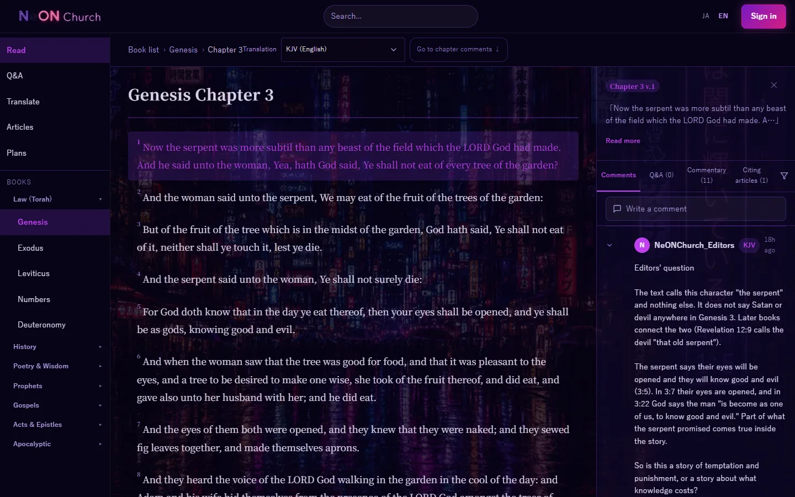
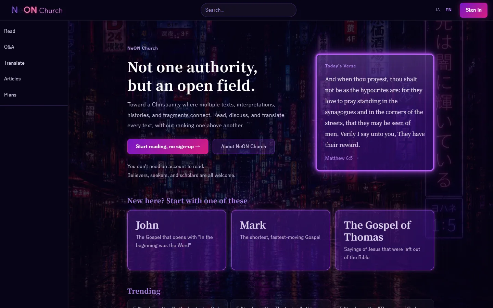
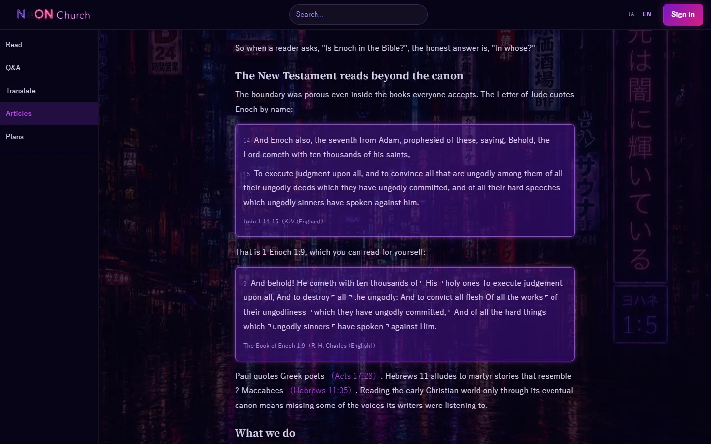
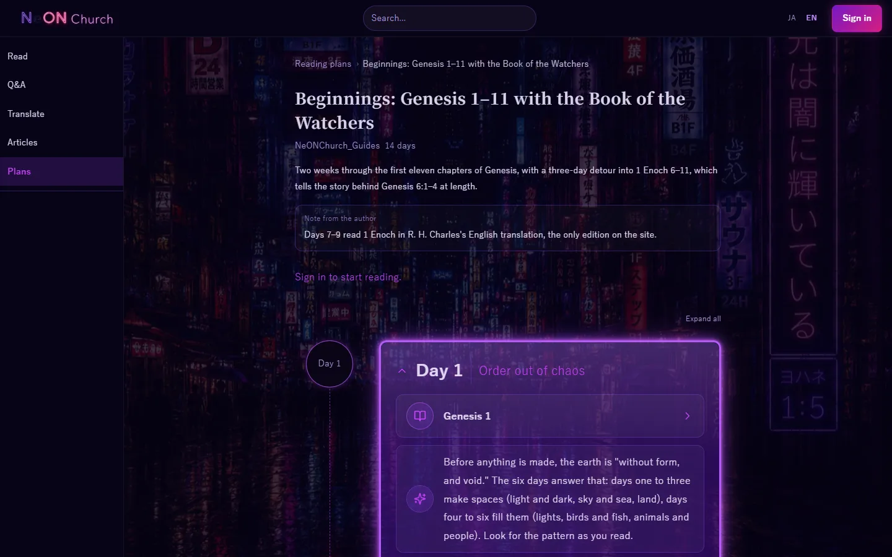
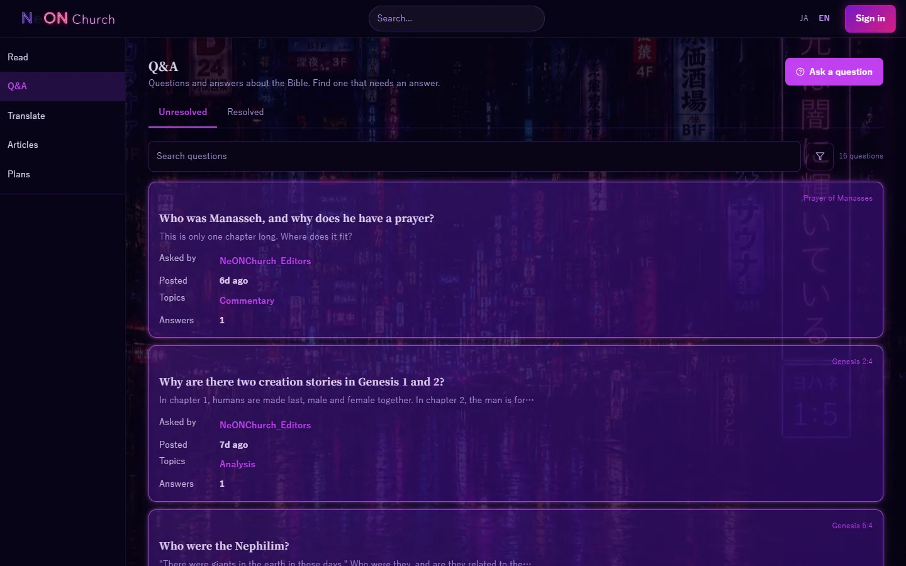
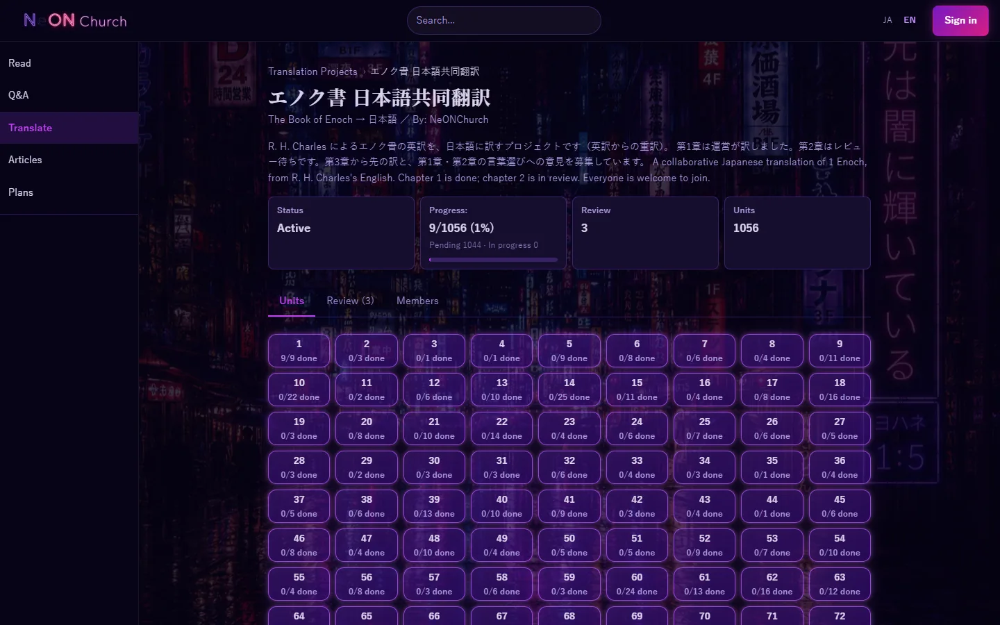

<div align="center">


# NeON Church

**Not a church as an institution, but an open field where texts and interpretations intersect.**

[](https://github.com/yuki-matsuno-525/NeON-Church/actions/workflows/frontend.yml)
[](https://github.com/yuki-matsuno-525/NeON-Church/actions/workflows/backend.yml)
[](https://github.com/yuki-matsuno-525/NeON-Church/actions/workflows/e2e.yml)


**[Live: neon-church.com](https://neon-church.com)** · [Codebase Guide (in Japanese)](docs/codebase-guide.md)

</div>

---

> **Public beta.** The site is open to everyone and still changing. Feedback is very welcome — see [Contact & feedback](#contact--feedback).

NeON Church reimagines Christianity not as a single fixed authority, but as an open field where multiple texts, interpretations, histories, and fragments connect. It draws on Kanzo Uchimura's Non-Church Christianity and a "database-like" reading of faith after postmodernism, shedding light on texts placed outside the canon and interpretations long marginalized. Every text is treated as equal — no second-class scriptures. Here you can read, annotate, discuss, and collaboratively translate biblical texts (canon, deuterocanon, Apocrypha, and Pseudepigrapha) together.

It is not a church organization or a devotional service. It is an experiment in reading together.

<div align="center">

<p><sub>Selecting a verse opens its discussion — Genesis 3:1 in the KJV, with the editors' question and readings</sub></p>
</div>

<table>
<tr>
<td width="50%"></td>
<td width="50%"></td>
</tr>
<tr>
<td align="center"><sub>Home — start reading without an account</sub></td>
<td align="center"><sub>Articles quote passages directly — here Jude 1:14–15 next to 1 Enoch 1:9</sub></td>
</tr>
<tr>
<td width="50%"></td>
<td width="50%"></td>
</tr>
<tr>
<td align="center"><sub>Reading plans that cross from Genesis into 1 Enoch</sub></td>
<td align="center"><sub>Q&A — unresolved / resolved tabs</sub></td>
</tr>
<tr>
<td colspan="2" align="center"></td>
</tr>
<tr>
<td colspan="2" align="center"><sub>A collaborative translation project — 1 Enoch into Japanese, verse by verse</sub></td>
</tr>
</table>

> The interface is bilingual. It opens in English; switch with the JA / EN toggle in the header.

## What's in the library

| Group | Examples | Editions |
|---|---|---|
| Hebrew Bible / Old Testament | Genesis – Malachi | KJV, 口語訳 (Japanese), 文語訳 (classical Japanese), Hebrew (WLC), Greek (LXX) |
| New Testament | Matthew – Revelation | KJV, 口語訳, 文語訳, Greek (Textus Receptus; Nestle 1904 for the Gospels) |
| Deuterocanon | Tobit, Judith, Wisdom, Sirach, Baruch, 1–4 Maccabees, 1 Esdras, Susanna, … | Brenton's English translation of the Greek |
| Other early texts | 1 Enoch, the Gospels of Thomas, Mary, Peter, Judas, Philip, Truth, Q, the Infancy Gospels, the Life of Adam and Eve, … | Public-domain English translations (R. H. Charles, Mark M. Mattison, and others) |
| Commentaries | Calvin, Rashi, Thomas Aquinas's *Catena Aurea*, church fathers (Augustine, Origen, Irenaeus, Chrysostom, …), Uchimura Kanzō | As published (public domain) |

Sources and licenses for every text are listed on the site at [/licenses](https://neon-church.com/licenses).

## Features

- **Scripture reading** — Book → chapter → verse, with an edition switcher on every chapter so you can compare translations and source texts.
- **Commentaries** — Read classic commentaries chapter by chapter, linked back to the verses they discuss.
- **Comments** — Post on a verse, a chapter, or a whole book. Threaded replies, upvotes, editing, deletion, and tagging.
- **Q&A** — Questions and answers live in their own app (`backend/qa/`), separate from comments. Ask, answer, and mark a best answer; the list is split into unresolved / resolved tabs.
- **Articles** — Write essays that cite passages inline (`[[matthew 6:16-18]]`) or quote them as blocks (`{{john 1:1-5|KJV}}`), including commentary sections. Public or private, with topics and their own comment threads.
- **Reading plans** — Build a plan of up to 365 days, mixing Bible chapters, other texts and commentary chapters; readers subscribe and track their progress chapter by chapter.
- **Collaborative translation** — Start a translation project and work verse by verse, with review and discussion.
- **Full-text search** — Searches across verse text, comment bodies, and book names (trigram indexes on Postgres).
- **Favorites** — Add verses, chapters, books, comments, and translation projects to your favorites; browse them from your profile.
- **Notifications** — Get notified about replies, mentions, and answers, with an unread badge.
- **Reading progress** — Remembers where you left off.
- **Profiles** — Bio, comment history, and (optionally public) favorites.

## About the seeded content

A new community starts empty, so the first articles, reading plans, discussion prompts, Q&A and translation projects were drafted by the site team **with AI assistance** and checked against the source texts. They are posted from three clearly named accounts — `NeONChurch`, `NeONChurch_Editors`, and `NeONChurch_Guides` — whose profiles say so. They are there to give early visitors something to respond to, not to imitate real users. The text lives in [`backend/common/launch_content/`](backend/common/launch_content/); corrections are welcome.

## Contact & feedback

| What | Where it goes |
|---|---|
| Feedback, bug reports, feature requests, privacy requests | The form at [neon-church.com/feedback](https://neon-church.com/feedback) — no account needed. Sent by email to the site team. |
| Email | [contact@neon-church.com](mailto:contact@neon-church.com) |
| Bugs and ideas in public | [GitHub Issues](https://github.com/yuki-matsuno-525/NeON-Church/issues) |
| A post that breaks the [community guidelines](https://neon-church.com/guidelines) | The **Report** menu on that post. Reports go to the moderators' admin queue. |

## Tech stack

| Layer | Technology |
|---------|------|
| Frontend | Next.js (App Router) |
| Backend | Django REST Framework |
| Database | PostgreSQL |
| Auth | JWT + HTTP-only cookies (djangorestframework-simplejwt) |
| Error monitoring | Sentry |
| OpenAPI | drf-spectacular |
| Tests (BE) | pytest / pytest-django |
| Tests (FE) | Vitest / React Testing Library / Playwright (E2E) |

## Deployment

| Service | Platform |
|---------|----------------|
| Frontend | Vercel |
| Backend | Render |
| Database | Render PostgreSQL |
| Uptime monitoring | Better Stack |
| CI/CD | GitHub Actions |

For launch, rollback and backup-restore procedures, see the [release runbook](docs/release-runbook.md) (in Japanese).

## Quick start

Prerequisites: Docker & Docker Compose, Git.

```bash
git clone https://github.com/yuki-matsuno-525/NeON-Church.git
cd NeON-Church
cp .env.example .env          # the defaults work as-is
docker-compose up --build     # the first build takes a few minutes
```

Once it is up:

| | URL |
|---|---|
| Frontend | http://localhost:3000 |
| Backend API | http://localhost:8000 |
| OpenAPI schema | http://localhost:8000/api/schema/swagger-ui/ |

<details>
<summary><b>Importing scripture texts</b></summary>

<br/>

```bash
# Kougo-yaku (the four Gospels, Japanese)
docker-compose exec backend python manage.py import_gospel

# KJV (English)
docker-compose exec backend python manage.py import_kvj

# Nestle 1904 (Greek source text, the four Gospels)
docker-compose exec backend python manage.py import_greek

# Whole-Bible translations from the ibibles dataset (several languages at once)
docker-compose exec backend python manage.py import_ibibles

# One book in one translation, from a normalized JSON file
docker-compose exec backend python manage.py import_scripture

# Coptic source texts
docker-compose exec backend python manage.py import_coptic

# Apocrypha and Pseudepigrapha in one go
# (Enoch, the Gospels of Mary / Peter / Judas, the Infancy Gospel of Thomas, the Life of Adam and Eve)
docker-compose exec backend python manage.py import_others
```

Text data lives in the `text/` directory.

### The Apocrypha / Pseudepigrapha import pipeline

These texts are imported in two stages: HTML → normalized JSON → database.

1. Parse (local only): a per-book parser under `bible/importers/` converts HTML into normalized JSON.
   Run `python -m bible.importers.cli all <book> <html>` to inspect the JSON and a preview.
2. Load: commit the reviewed JSON to `backend/bible/seed/others/`, and `import_others` loads every
   JSON file into the database (idempotent).

The production image on Render does not include `text/`, so the finalized JSON under `seed/others/`
ships with the image instead of the HTML, and `import_others` loads it in one shot.
**Run this in the Render shell after deploying:**

```bash
python manage.py migrate        # if there are unapplied migrations
python manage.py import_others  # loads the texts (idempotent — safe to re-run)
```

</details>

<details>
<summary><b>Loading seed data</b></summary>

<br/>

Seed data reproduces what the service looks like once people are actually using it.
Everything comes from one command, `seed_demo`, which mixes Japanese and English users.

**With Docker:**

```bash
# Wipe existing user data and load the full-size seed (a few minutes)
docker-compose exec backend python manage.py seed_demo --wipe

# A smaller set, enough to click through every screen
docker-compose exec backend python manage.py seed_demo --wipe --scale large
```

**Without Docker (SQLite E2E setup):**

```bash
cd backend
DJANGO_SETTINGS_MODULE=config.settings.e2e python manage.py seed_demo --wipe --scale small
```

`--wipe` removes every non-staff user and everything people created (comments, Q&A,
articles, plans, translation projects, favorites, notifications). Scripture itself
(`CanonicalBook` / `Book` / `Chapter` / `Verse`) is never touched. Without `--wipe` the
command refuses to run on a database that already has data, so it cannot double up.

What `--scale xl` (the default) creates:

| Data | Count |
|--------|------|
| Users | 220 (half Japanese, half English, varied bios) |
| Comments | 20,000+ (verse / chapter / book level, reply trees of depth 5, soft deletes) |
| Votes | 80,000+ |
| Q&A | 400 questions / 1,800+ answers (half solved, one question with 80+ answers) |
| Articles | 400 (public / unlisted / draft, every citation form including a broken one) |
| Article comments | 3,900 (one article carries 150) |
| Plans | 120 (3 to 365 days, canon and apocrypha mixed, subscriptions and progress) |
| Translation projects | 40 (all statuses, all membership states, all unit states) |
| Favorites | 6,000+ (books, chapters, verses, comments, translation projects) |
| Notifications | 14,000+ (reply / upvote / mention, read and unread) |
| Reports | 300 (comments, questions and answers) |

> The command prints one shared password for the seeded users when it finishes.
> It also creates an admin account if the database has no superuser yet, and prints
> that password once.

**Launch content (`seed_launch`):**

`seed_demo` is for testing only. The posts that stay in production — articles, reading plans,
comments, Q&A and translation projects written by the site team — come from a separate command.
The text lives in `backend/common/launch_content/`; edit it there.

```bash
python manage.py seed_launch            # create the three NeONChurch accounts and their posts
python manage.py seed_launch --dry-run  # show counts and any passages missing from this database
python manage.py seed_launch --replace  # delete the operator accounts' posts and load them again
python manage.py seed_launch --wipe     # delete all existing user data first (keeps scripture, commentaries, admins)
```

Without `--wipe` it never touches other users' posts (except replies attached to operator posts
when you use `--replace`). `--wipe` deletes every non-staff user and everything people created,
in the same transaction as the load, so a failure leaves the database unchanged. Passages that are not in the database are skipped and listed at the end.

</details>

<details>
<summary><b>Admin user, stopping and resetting containers</b></summary>

<br/>

```bash
# Create an admin user (Django Admin: http://localhost:8000/admin/)
docker-compose exec backend python manage.py createsuperuser

# Stop
docker-compose down

# Reset, dropping the database volume (deletes all data)
docker-compose down -v
```

</details>

<details>
<summary><b>Tests</b></summary>

<br/>

```bash
# Backend
docker-compose exec backend pytest

# Frontend (unit)
docker-compose exec frontend npm test

# Frontend (E2E — builds and starts the app, then drives it with Playwright)
docker-compose exec frontend npx playwright test
```

Run the frontend commands inside the container. Starting a second dev server on the host
breaks the one in Docker: `docker-compose.yml` mounts `./frontend` into the container, so
both processes share the same `.next` directory.

</details>

<details>
<summary><b>Environment variables</b></summary>

<br/>

See `.env.example`. The main ones:

| Variable | Description |
|-------|------|
| `DJANGO_SECRET_KEY` | Django secret key (use a long random string in production) |
| `DJANGO_DEBUG` | `True` (development) / `False` (production) |
| `DJANGO_ALLOWED_HOSTS` | Allowed hosts (comma-separated) |
| `CSRF_TRUSTED_ORIGINS` | Origins trusted for CSRF |
| `POSTGRES_*` | PostgreSQL connection settings |
| `NEXT_PUBLIC_API_BASE_URL` | Backend API URL used by the frontend |
| `NEXT_PUBLIC_SITE_URL` | Public domain (used as the OGP `metadataBase`) |
| `NEXT_ALLOWED_DEV_ORIGINS` | Extra comma-separated hosts allowed to load the Next.js dev UI (local browser testing only) |
| `GOOGLE_CLIENT_ID/SECRET` | Google OAuth credentials |
| `GITHUB_CLIENT_ID/SECRET` | GitHub OAuth credentials |
| `EMAIL_HOST/PORT/USE_TLS` | SMTP connection used for password reset and feedback |
| `EMAIL_HOST_USER/PASSWORD` | SMTP credentials |
| `DEFAULT_FROM_EMAIL` | Sender address for service emails |
| `FEEDBACK_EMAIL` | Recipient for feedback submissions |
| `NEXT_PUBLIC_OAUTH_*_ENABLED` | Feature flags for the OAuth buttons |
| `SENTRY_DSN` | Sentry DSN (optional) |

</details>

<details>
<summary><b>API overview</b></summary>

<br/>

Base URL: `http://localhost:8000/api/`

| Endpoint | Description |
|--------------|------|
| `GET /books/` | List books |
| `GET /books/{id}/chapters/` | List chapters |
| `GET /chapters/{id}/verses/` | List verses |
| `GET/POST /comments/` | Read and post comments |
| `POST /comments/{id}/upvote/` | Upvote |
| `GET/POST /bookmarks/` | List and create favorites |
| `GET /notifications/` | List notifications |
| `GET /search/?q=...&kind=...` | Full-text search (verses / books / comments) |
| `GET/POST /qa/questions/` | List and post questions |
| `GET/POST /qa/questions/{id}/answers/` | List and post answers |
| `GET/POST /articles/` | List and create articles |
| `GET/POST /plans/` | List and create reading plans |
| `GET/POST /translations/` | List and create translation projects |
| `POST /auth/register/` | Register |
| `POST /auth/login/` | Log in |
| `POST /auth/logout/` | Log out |
| `GET /auth/me/` | Current user |
| `GET /users/{username}/` | Another user's profile |

The full schema is available at `/api/schema/swagger-ui/`.

</details>

<details>
<summary><b>Project layout</b></summary>

<br/>

```
NeON-Church/
├── backend/             # Django REST Framework
│   ├── bible/           # Book / chapter / verse models, search
│   ├── comments/        # Comments, tags, upvotes
│   ├── qa/              # Questions and answers (separate from comments)
│   ├── articles/        # Articles, topics, citations
│   ├── plans/           # Reading plans, days, subscriptions
│   ├── bookmarks/       # Favorites
│   ├── notifications/   # Notifications
│   ├── reading_progress/# Reading progress
│   ├── translations/    # Collaborative translation projects
│   ├── commentary/      # Commentaries (works, chapters, sections, links to verses)
│   ├── common/          # Shared pieces: language, wipe, seed commands, launch content
│   ├── users/           # Auth and profiles
│   ├── config/          # Django settings and URL routing
│   └── tests/           # Test suite
├── frontend/            # Next.js
│   └── src/
│       ├── app/         # App Router pages
│       ├── components/  # UI components
│       ├── contexts/    # AuthContext, LanguageContext, NotificationContext
│       ├── hooks/       # Custom hooks such as useComments
│       └── lib/         # API client and type definitions
├── text/                # Scripture text data (for importing)
├── plan/                # Design documents (one per body of work)
├── docs/                # Codebase guide (Japanese)
└── docker-compose.yml
```

</details>

<details>
<summary><b>Authentication flow</b></summary>

<br/>

1. `POST /api/auth/login/` sets an access token (20 minutes) and a refresh token (20 days) as HTTP-only cookies
2. Subsequent requests send the cookies automatically
3. An expired access token is refreshed automatically (with refresh token rotation)
4. Logging out clears the cookies and revokes the refresh token

</details>

## License

The source code is under the [MIT License](LICENSE). The texts in the library (scripture, translations, commentaries) follow the licenses of their sources — see [/licenses](https://neon-church.com/licenses) on the site.
